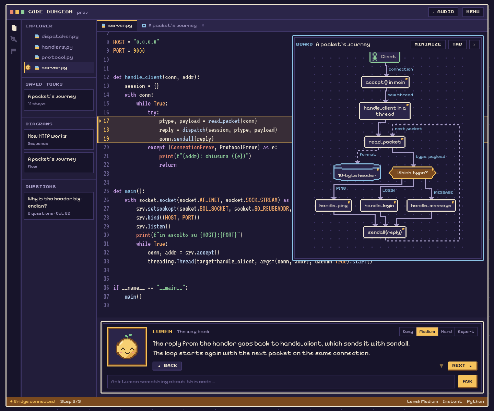
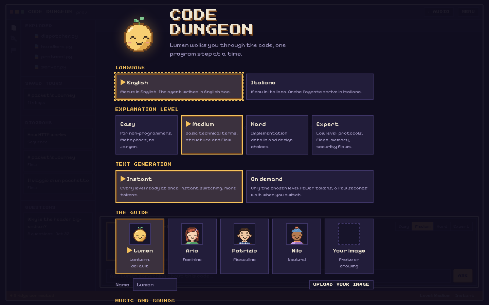
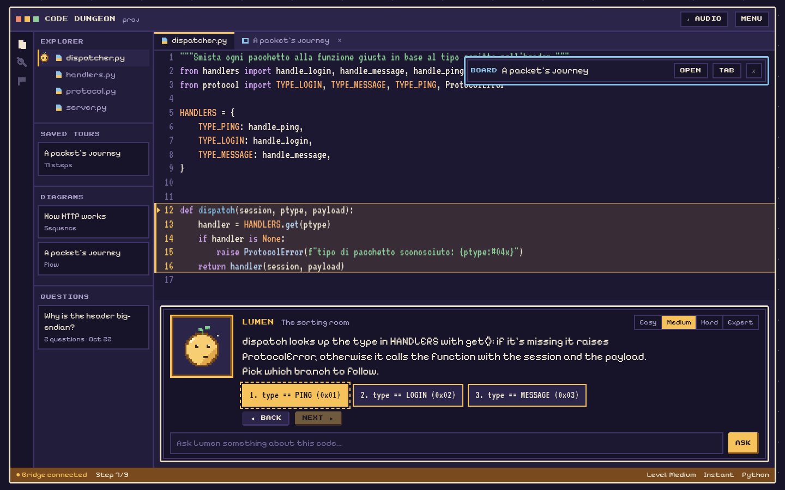
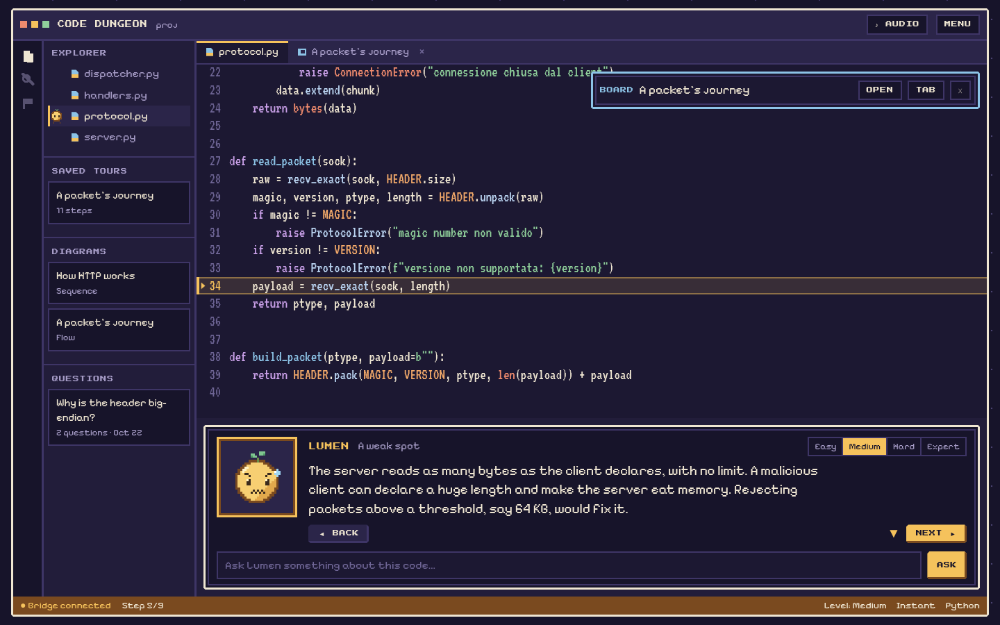
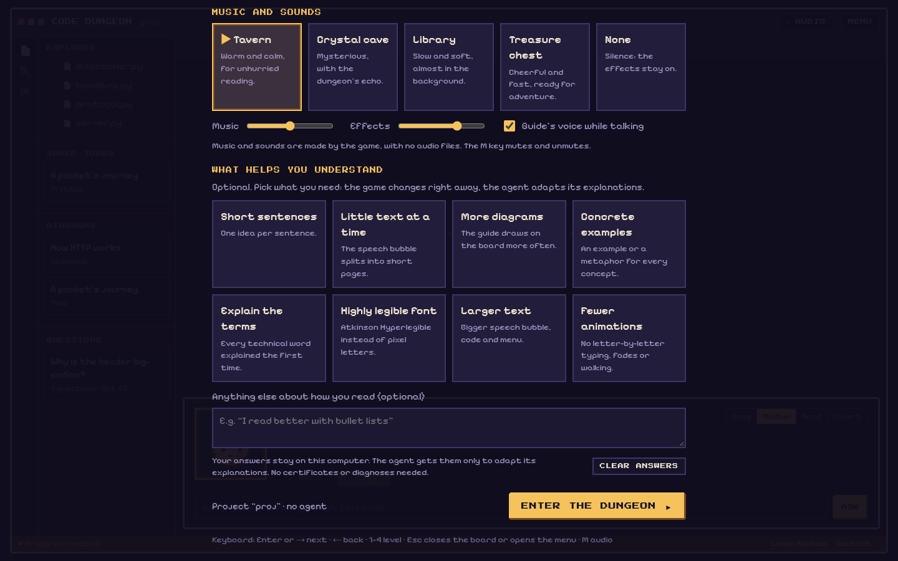
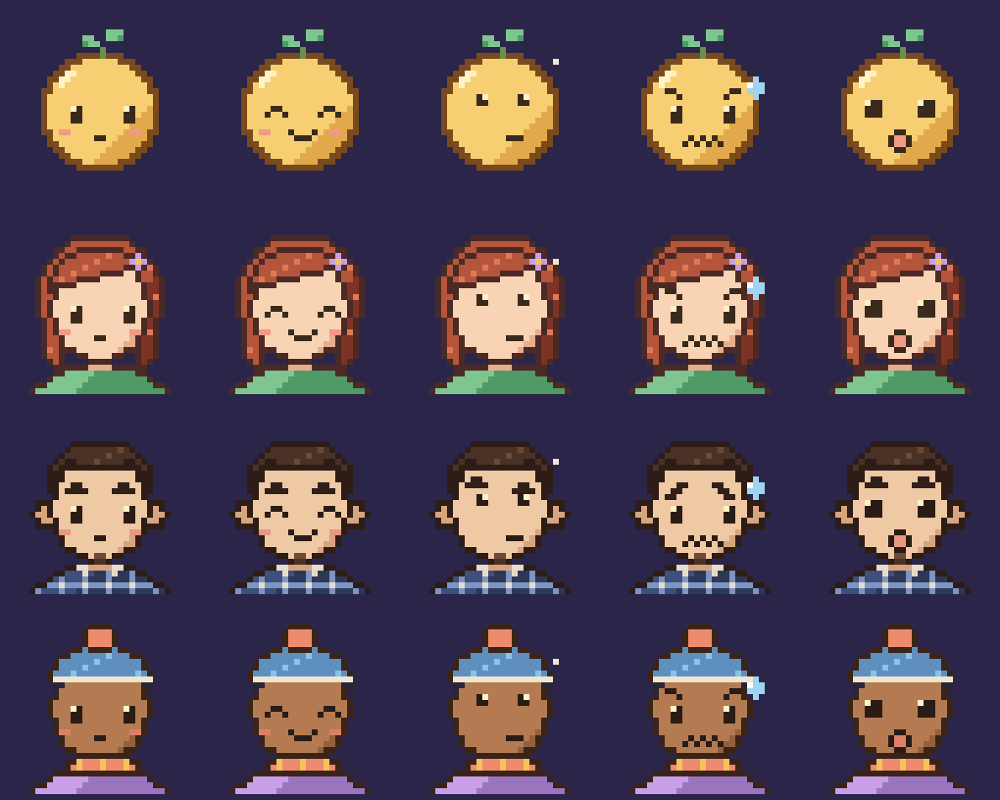

# Code Dungeon

<p align="center"></p>

A cozy pixel-art game that explains code written by LLMs. A guide (Lumen, a little lantern, or one you pick) walks you through a pixelated VS Code and follows the **real flow of the program**: from the packet that arrives to the function that answers it.

The game is an **MCP server**: it has no agent of its own and is driven by the one you already use (Claude Code, Codex, Gemini CLI or any MCP client). The agent builds the tour with the game's tools and answers your questions live.

```
agent (Claude Code / Codex / Gemini CLI) ──MCP stdio──▶ Code Dungeon server ──WebSocket──▶ game in the browser or the app
                                                         │
                                                         └─ .tour/ in your project: tours, diagrams and conversations
```

## Status: stage 10 of 10 in progress

Already working:

- interface in English (default) or Italian, chosen in the menu. The agent receives the chosen language and writes tours and answers in it;
- pixelated VS Code editor with syntax highlighting (Python, JS/TS) and line highlighting;
- the guide with 5 animated expressions and a mini guide that walks between files, with a pixel dissolve when the file changes;
- guide chosen in the menu: Lumen, Aria, Patrizio, Nilo, or your own photo or drawing turned into pixel art (three compression levels side by side and a slider), with automatic expressions or one uploaded per expression; you pick the name. The image stays in the browser;
- JSON tours with branches (choices in the dialog), forward and back;
- start menu with 4 levels (Easy, Medium, Hard, Expert) and a generation mode; the level can be changed during the tour;
- live questions: you type them in the game, the agent reads them and answers in the speech bubble. Select some code (or part of the guide's text) and press "Ask about this": the agent receives the selected text with the question;
- question history: every conversation is saved in `.tour/conversazioni/` and stays in the "Questions" list. One click replays it with the code and diagrams of the answer; if you type while reading an answer, the question continues that conversation and the agent also receives the previous questions and answers;
- "What helps you understand" questionnaire in the menu: short sentences, little text at a time (paged bubble), more diagrams, examples, explained terms, a highly legible font (Atkinson Hyperlegible), larger text, fewer animations. The game adapts at once; the agent receives the requests and adapts its explanations;
- video-game music and sounds: four chiptune soundtracks to choose from, interface effects and the guide's beeping voice while it talks, with a different timbre for each portrait. All generated by the game, no audio files; separate volumes and the M key to mute;
- settings saved in SQLite on your computer, the same across all projects;
- diagram board: the agent draws flows and sequences in pixel art, piece by piece while it explains; the diagram pops up in a window and stays as an editor tab (and in the "Diagrams" list);
- comfortable reading: A− / A+ in the title bar (or the + and − keys) change the text size; drag the dividers to widen the code, shrink the guide panel or close the explorer, and drag the corner of the board window to make the diagram bigger (double click resets); the corners button in the title bar (or the F key, F11 in the app) switches to full screen;
- phone layout;
- optional desktop app (Tauri): the game in its own window, which finds the open session by itself;
- sample project `examples/packet-server` (a TCP server in Python) with an 11-step tour, including a real DoS flaw.

## A look inside

<table>
  <tr>
    <td width="50%"></td>
    <td width="50%"></td>
  </tr>
  <tr>
    <td><b>Start menu.</b> Pick the language, how deep the explanation goes and your guide.</td>
    <td><b>Branches.</b> Where the program branches, you choose which path to follow.</td>
  </tr>
  <tr>
    <td></td>
    <td></td>
  </tr>
  <tr>
    <td><b>Real flaws.</b> The guide gets worried when it finds a bug or a security hole.</td>
    <td><b>Made for you.</b> Chiptune music, and options that change how the game and the agent explain.</td>
  </tr>
</table>

<p align="center"><br><sub>The four guides and their five expressions. You can also use your own photo or drawing.</sub></p>

The full roadmap is in [docs/progetto.md](docs/progetto.md) (in Italian).

## Installing from scratch

This guide starts from a computer with nothing installed. The MCP server is installed once and then works in all your projects. It takes about ten minutes.

### 1. What you need

- **Node.js 22.13 or later** (it needs the built-in SQLite module). Check with `node --version`. If it's missing or old, install it from [nodejs.org](https://nodejs.org) (LTS version) or with your system's package manager (`brew install node`, `sudo dnf install nodejs`, `sudo apt install nodejs npm`, `winget install OpenJS.NodeJS.LTS`).
- **Git**, to download the repository (`git --version`).
- **A terminal agent**, installed and working: [Claude Code](https://docs.claude.com/en/docs/claude-code), [Codex CLI](https://github.com/openai/codex) or [Gemini CLI](https://github.com/google-gemini/gemini-cli). Any other MCP client works too.
- **A browser**, where you play (or the [desktop app](#desktop-app-optional)).

### 2. Download and build Code Dungeon

Pick a folder to keep it in, for example your home, and leave it there: the agent starts it from that path.

```bash
cd ~
git clone https://github.com/Armidon1/CodeDungeon.git code-dungeon
cd code-dungeon
npm install
npm run build
```

`npm run build` creates `dist/server` (the MCP server) and `dist/game` (the game). If it finishes without errors, you're ready.

### 3. Note the server path

The command to give the agent is `node <path>/dist/server/cli.js mcp`. Print the full path with:

```bash
echo "$(pwd)/dist/server/cli.js"      # macOS and Linux
```

On Windows (PowerShell) use `"$PWD\dist\server\cli.js"`. In the examples below, replace `/path/to/code-dungeon` with your folder: it must be an **absolute path**, not `~/…` or relative.

Check that the server starts on its own (optional):

```bash
npm run play -- --project examples/packet-server
```

Open http://127.0.0.1:7337: you see the game menu and can play the sample tour. Stop it with Ctrl+C.

### 4. Register the server with your agent

Do it for the agent you use. The server works on the folder where you start the agent: you don't need to point it at a project.

**Claude Code**

```bash
claude mcp add --scope user code-dungeon -- node /path/to/code-dungeon/dist/server/cli.js mcp
```

`--scope user` makes it available in every folder. Check with `claude mcp list`: `code-dungeon` must show `✓ Connected`. Inside a session, the `/mcp` command shows the same status.

**Codex CLI**

Add to `~/.codex/config.toml` (create it if it doesn't exist):

```toml
[mcp_servers.code-dungeon]
command = "node"
args = ["/path/to/code-dungeon/dist/server/cli.js", "mcp"]
tool_timeout_sec = 1800   # wait_for_question listens longer than the default 60 seconds
```

Alternatively run `codex mcp add code-dungeon -- node /path/to/code-dungeon/dist/server/cli.js mcp`, then add the `tool_timeout_sec` line by hand. Check with `codex mcp list`, or with `/mcp` inside Codex. Codex asks for permission before using a tool: approve it (you can choose "always" for the session).

**Gemini CLI**

Add to `~/.gemini/settings.json` (for all projects) or to `.gemini/settings.json` inside a project:

```json
{
  "mcpServers": {
    "code-dungeon": {
      "command": "node",
      "args": ["/path/to/code-dungeon/dist/server/cli.js", "mcp"]
    }
  }
}
```

If the file already has other settings, add only the `code-dungeon` entry inside `mcpServers`. Check with `/mcp` inside Gemini CLI.

**Other MCP clients**

The server speaks MCP over stdio. Command `node`, arguments `["/path/to/code-dungeon/dist/server/cli.js", "mcp"]`. For a project other than the working folder, add `"--project", "/path/to/the/project"`.

### 5. Your first tour

1. In the terminal, go into the project you want explained and start the agent (`claude`, `codex` or `gemini`).
2. Ask: *"Create a Code Dungeon tour of how this program handles a request"*. In Claude Code there is also the `/mcp__code-dungeon__crea_tour` command.
3. The agent reads the code, writes the tour and gives you the game's address: usually http://127.0.0.1:7337. If the port is taken it uses the next free one, so open the address it gives you. With several agents open at once, click the project name in the game's title bar to switch session.
4. In the game, pick the level and follow the guide. Type your questions directly in the game: the answer arrives in the speech bubble.

Tours, diagrams and conversations are saved in `.tour/` in your project.

> **Tip: add `.tour/` to your project's `.gitignore`.** The folder is generated by Code Dungeon and also holds your questions to the agent, which are personal. If you want to share a tour with whoever clones the project, at least leave out the conversations:
>
> ```gitignore
> # everything Code Dungeon generates
> .tour/
> # or just the conversations
> .tour/conversazioni/
> ```

### Troubleshooting

- **The agent doesn't see the Code Dungeon tools.** Restart the agent after registering the server and check with `/mcp` or `mcp list`. If it shows as not connected, the `cli.js` path is usually wrong or you didn't run `npm run build`.
- **`node: command not found` or a syntax error at startup.** Node is missing or older than 22.13.
- **The game doesn't open.** The server starts together with the agent, so the agent must be running. Ask it for the exact address (`get_game_state` tool).
- **You type a question in the game and nothing happens.** See [Questions without going back to the terminal](#questions-without-going-back-to-the-terminal). If the agent ended its turn, write *"answer the questions in the game"* in its terminal.

### Updating

```bash
cd /path/to/code-dungeon
git pull
npm install
npm run build
```

Then restart the agent. You don't need to register the server again.

## Try it now, without an agent

```bash
npm run play -- --project examples/packet-server
```

Open http://127.0.0.1:7337 and pick the level. In this mode you can play saved tours but not ask questions.

## Desktop app (optional)

The game can live in its own window instead of a browser tab. The app contains only the game: the server is still started by the agent (or by `npm run play`). When it opens, it looks for open sessions on ports 127.0.0.1:7337-7356 and, if there is none, waits for one to start. With one session it connects straight away; with several it lists them (project, port, agent) and you choose. Click the project name in the title bar to switch session at any time.

### 1. Build it

You need [Rust](https://rustup.rs) and, on Linux, the WebKitGTK libraries:

- Fedora: `sudo dnf install webkit2gtk4.1-devel openssl-devel`
- Debian/Ubuntu: `sudo apt install libwebkit2gtk-4.1-dev libssl-dev build-essential`

On Windows and macOS, Rust is enough (on macOS also the Xcode tools: `xcode-select --install`). Then, from the Code Dungeon folder:

```bash
npm run app:build                      # every package for your system
npm run app:build -- --bundles rpm     # only the one you need (rpm, deb, appimage, nsis, dmg)
```

The app weighs a few MB because it uses the system's web engine.

### 2. Open or install it

**Without installing anything**, on any system:

```bash
./src-tauri/target/release/code-dungeon        # Linux and macOS
.\src-tauri\target\release\code-dungeon.exe     # Windows
```

**Fedora, openSUSE** (`.rpm` package):

```bash
sudo dnf install "./src-tauri/target/release/bundle/rpm/Code Dungeon-0.1.0-1.x86_64.rpm"
```

**Debian, Ubuntu, Mint** (`.deb` package):

```bash
sudo apt install "./src-tauri/target/release/bundle/deb/Code Dungeon_0.1.0_amd64.deb"
```

**Other distributions** (AppImage, no installation):

```bash
chmod +x src-tauri/target/release/bundle/appimage/*.AppImage
./src-tauri/target/release/bundle/appimage/*.AppImage
```

**Windows**: run the installer in `src-tauri\target\release\bundle\nsis\` (`Code Dungeon_0.1.0_x64-setup.exe`).

**macOS**: open the `.dmg` in `src-tauri/target/release/bundle/dmg/` and drag Code Dungeon into Applications.

Once installed, you'll find it in the applications menu as "Code Dungeon", with Lumen's icon. On Linux it also opens from the terminal with `code-dungeon`.

### 3. Use it

Open a session first: ask your agent for a tour, or run `npm run play -- --project <folder>`. If you open the app first, it shows "Looking for an open session…" and connects by itself as soon as one starts.

### Uninstalling

- Fedora: `sudo dnf remove code-dungeon`
- Debian/Ubuntu: `sudo apt remove code-dungeon`
- Windows: from Settings → Apps
- macOS: drag Code Dungeon from Applications to the Trash

So far tested on Fedora (rpm and deb built, executable launched). Windows, macOS and AppImage have not been tested yet.

## Questions without going back to the terminal

After starting a tour or answering a question, the agent keeps listening on its own (`wait_for_question`): type in the game and the answer arrives in the speech bubble, with any agent. To talk to it about something else in the terminal, interrupt it (Esc in Claude Code). Some agents (e.g. Codex) sometimes end their turn instead of waiting: the question isn't lost, and after 30 seconds the game reminds you to write *"answer the questions in the game"* to the agent.

**Extra for Claude Code.** Code Dungeon is also a *channel*: an experimental Claude Code feature that lets a server push a message into the session without being called. Questions then arrive by themselves and the terminal stays free. Other agents ignore it. To turn it on:

```bash
claude --dangerously-load-development-channels server:code-dungeon
```

and confirm the initial warning (needed because home-made channels aren't on the approved list yet).

## MCP tools

| Tool | What it does |
| --- | --- |
| `list_project_files` | lists the project files |
| `open_file` | opens a file in the editor, with the animation |
| `highlight_lines` | highlights a range of lines |
| `show_dialog` | makes the guide speak, with an expression |
| `get_game_state` | current level, file, lines and step |
| `get_user_questions` | reads and clears the questions typed in the game |
| `wait_for_question` | listens and returns the next question as soon as it's typed |
| `get_conversation` | rereads a conversation saved in `.tour/conversazioni/` (without an id, lists them) |
| `create_tour`, `add_step`, `set_step_text` | build the script in `.tour/` |
| `list_tours`, `get_tour`, `play_tour` | list, read and start tours |
| `draw_diagram` | draws and saves a diagram in `.tour/schemi/` |
| `reveal_diagram` | shows a saved diagram, even just its first pieces |
| `set_step_diagram` | links a diagram to a tour step |

Prompt: `crea_tour` (full guide in [docs/come-fare-un-tour.md](docs/come-fare-un-tour.md), in Italian).

## Development

```bash
npm run dev          # game with hot reload on http://localhost:5173 (finds the open sessions like the desktop app)
npm run play -- --project examples/packet-server    # in another terminal
npm run typecheck
npm run test:mcp     # end-to-end test: fake agent + fake game
npm run build:demo   # a single HTML file with the sample embedded, no bridge
npm run app:dev      # desktop app (Tauri) connected to `npm run dev`
npm run app:build    # desktop app built, packages in src-tauri/target/release/bundle/
```

## Security

- The bridge listens only on `127.0.0.1` and accepts WebSockets only from local pages, to block cross-site WebSocket hijacking.
- The server reads only inside the project folder: absolute paths, `../` and symbolic links that leave it are rejected.
- In the project it writes only to `.tour/`, with validated ids and atomic writes.
- Outside the project it writes a single file: `code-dungeon.db` (SQLite) with your settings and questionnaire answers, in the user data folder (`~/.local/share/code-dungeon` on Linux, `~/Library/Application Support/code-dungeon` on macOS, `%APPDATA%\code-dungeon` on Windows; change it with `CODE_DUNGEON_DATA`). It doesn't end up in Git and doesn't leave your computer, except for what the agent reads to adapt its explanations. The game doesn't ask for certificates or diagnoses.
- Files over 512 KB or binary files are not opened.
- Questions pushed into the Claude Code session come only from the game open locally (same origin check).
